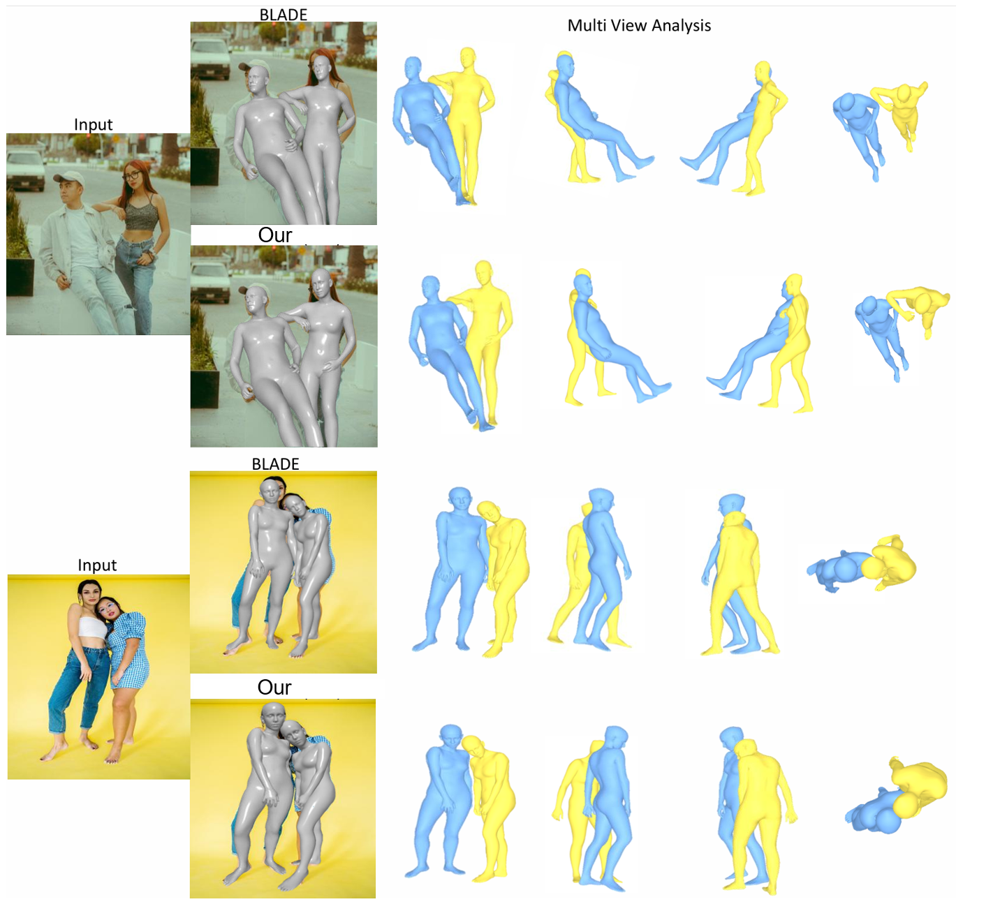

# U-HYDRA

**U-HYDRA: Uncertainty-Aware Multi-Hypothesis Depth Reasoning for Multi-Person Perspective Distortion Mesh Recovery**

## Qualitative Results

### Distorted Images

### Distorted Images 2

### Examples from 3DPW

### Multi-person Human Mesh Recovery

### Multi-View Mesh Rendering

